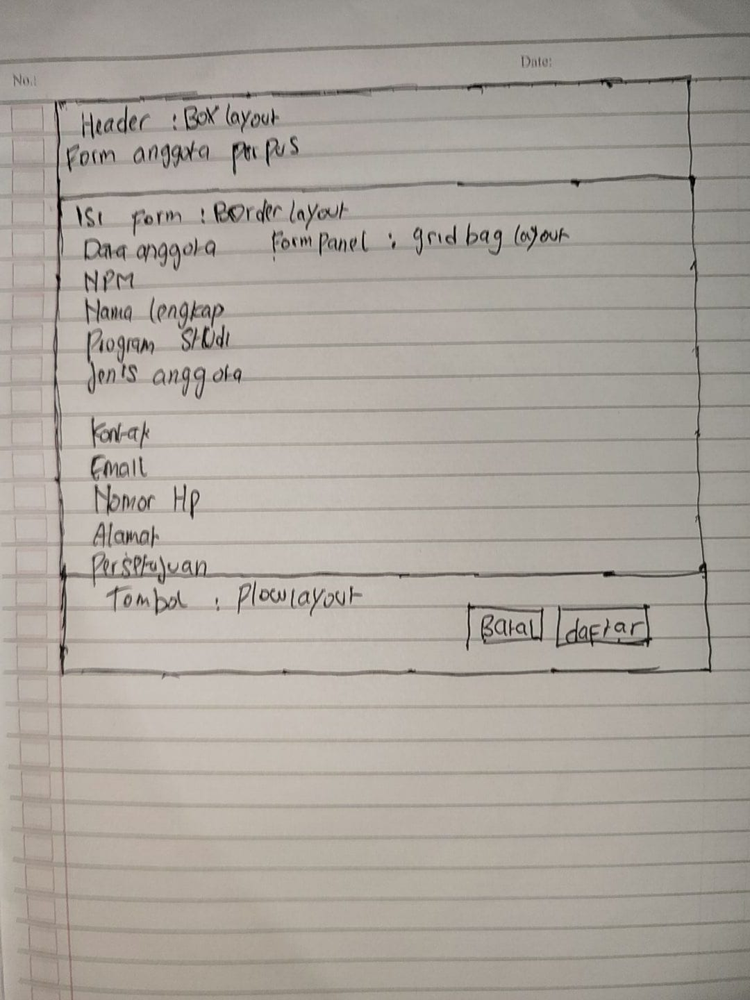
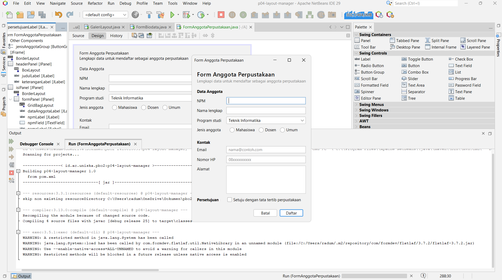
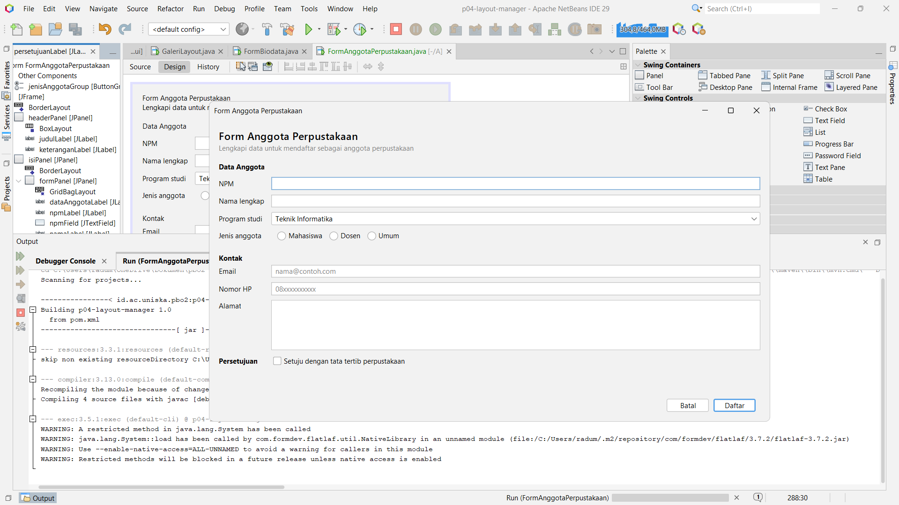
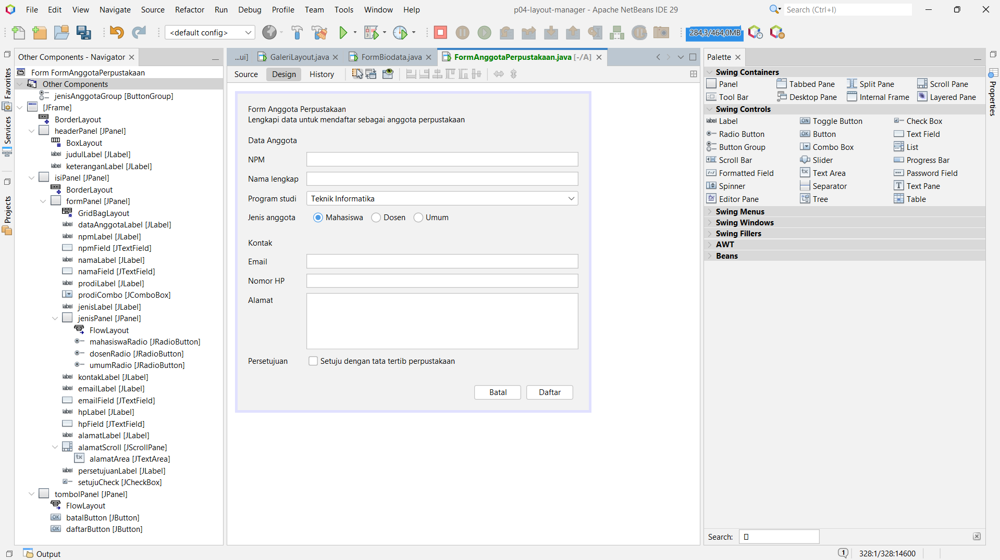

# Tugas 4 - Layout Manager dan Desain Form

**Nama:** M. Radu Al-malikar
**NPM:** 2410010095

## Form Anggota Perpustakaan

### Sketsa

### Tabel Rancangan

| Bagian | Panel | Layout |
|---|---|---|
| Jendela | JFrame | BorderLayout |
| Header | headerPanel | BoxLayout (Y Axis) |
| Isi form | isiPanel dan formPanel | BorderLayout, lalu GridBagLayout |
| Tombol | tombolPanel | FlowLayout (Right) |

### Ukuran Awal

### Saat Dilebarkan

### Tab Design dengan Navigator

## Eksperimen Praktikum 2

1. Pada flowPanel, ubah Alignment layout menjadi Center, lalu kecilkan jendela. Apa yang berubah? Baris mana di initComponents() yang ikut berubah?

- Button berubah ke tengah, dan saat jendela dikecilkan button turun ke baris berikutnya. Baris yang berubah: flowPanel.setLayout(new java.awt.FlowLayout(java.awt.FlowLayout.CENTER, 8, 8));

2. Pada gridPanel, ubah Rows menjadi 0 dan Columns menjadi 2. Berapa baris yang terbentuk dan mengapa?

- Terbentuk 5 baris. Karena Rows bernilai 0, jumlah baris dihitung otomatis dari jumlah button dibagi jumlah kolom (9 dibagi 2 dibulatkan ke atas), sehingga 4 baris penuh dan 1 baris berisi satu button.

3. Pada boxPanel, isi properti maximumSize keempat tombol dengan lebar 32767 dan tinggi sama dengan tinggi tombol. Bagaimana lebar tombol berubah? Tambahkan juga Vertical Strut dari kategori Swing Fillers di antara tombol.

- Lebar tombol berubah dari selebar teksnya menjadi memenuhi lebar panel, karena BoxLayout mengikuti ukuran maximumSize. Saat jendela dilebarkan, keempat tombol ikut melebar. Vertical Strut memberi jarak tetap antar tombol.

## Eksperimen Praktikum 4

1. Ubah Weight X pada namaField menjadi 0.0, lalu lebarkan jendela. Apa yang terjadi pada isian?

- Tidak ada perubahan, namaField tetap ikut melebar. Di GridBagLayout, pembagian sisa lebar dihitung per kolom dari Weight X terbesar di kolom itu. Isian lain di kolom 1 masih 1.0, jadi kolomnya tetap melebar dan namaField yang Fill-nya Horizontal tetap memenuhi selnya.

2. Ubah Direction formPanel di dalam isiPanel dari North menjadi Center, lalu tinggikan jendela. Apa perbedaannya?

- Saat jendela ditinggikan, formPanel ikut mengisi seluruh tinggi isiPanel sehingga baris-baris form turun ke tengah dan ada ruang kosong di atas dan bawah. Dengan North, formPanel hanya setinggi isinya sehingga baris form tetap menempel di atas.

3. Hapus baris setMinimumSize(getSize()) di konstruktor, lalu kecilkan jendela sekecil mungkin. Bagian mana yang rusak lebih dulu?

- Tanpa setMinimumSize, jendela bisa dikecilkan sampai lebih kecil dari ukuran awalnya. Isian dan teks mulai terpotong, lalu bagian bawah form ikut tertutup. Dengan setMinimumSize, jendela berhenti di ukuran awal sehingga semua komponen tetap terlihat.

## Pertanyaan Refleksi

**1. Mengapa Null Layout dan Absolute Layout sebaiknya dihindari?**

- Keduanya memakai posisi piksel yang tetap sehingga tampilan tidak menyesuaikan ukuran jendela dan teks dapat terpotong pada skala layar berbeda. Absolute Layout juga membutuhkan library tambahan NetBeans sehingga aplikasi sulit dijalankan di komputer lain.

**2. Jelaskan perbedaan perilaku FlowLayout dan GridLayout saat jendela dilebarkan.**

- FlowLayout mempertahankan ukuran asli komponen, komponen berderet dan pindah baris jika tidak muat. GridLayout membagi ruang menjadi sel sama besar, sehingga semua komponen ikut melebar mengisi jendela.

**3. Apa fungsi Weight X dan Fill pada constraint GridBagLayout?**

- Weight X menentukan pembagian sisa lebar antar kolom: 0.0 berarti kolom tidak melebar, 1.0 berarti kolom mengambil sisa lebar. Fill menentukan apakah komponen memenuhi selnya; Horizontal membuat isian mengisi lebar sel. Keduanya dipakai bersama pada kolom isian agar melebar saat jendela dilebarkan.

**4. Mengapa formPanel dibungkus isiPanel dan diletakkan di North?**

- BorderLayout menempatkan komponen di North setinggi isinya saja. Jika formPanel langsung di Center, formPanel ikut melar saat jendela ditinggikan dan baris form menjadi tersebar. Dengan dibungkus isiPanel di North, baris form tetap menempel di atas dan sisa tinggi menjadi ruang kosong di bawah.

**5. Sebutkan dua prinsip desain yang Anda terapkan pada Form Anggota Perpustakaan dan tunjukkan buktinya.**

- Keselarasan: label berada di kolom 0 dan isian di kolom 1 sehingga membentuk garis lurus dari atas ke bawah. Buktinya terlihat pada Default.png.
- Kedekatan: isian yang berkaitan dikelompokkan dengan judul bagian Data Anggota, Kontak, dan Persetujuan. Buktinya terlihat pada Default.png dan Lebar.png.

## Deklarasi Penggunaan AI

- Saya memakai Claude (Anthropic) untuk menjelaskan langkah pengerjaan modul, memeriksa kode hasil NetBeans, dan membantu merapikan jawaban eksperimen dan refleksi. Tampilan form disusun sendiri di tab Design memakai JFrame Form.