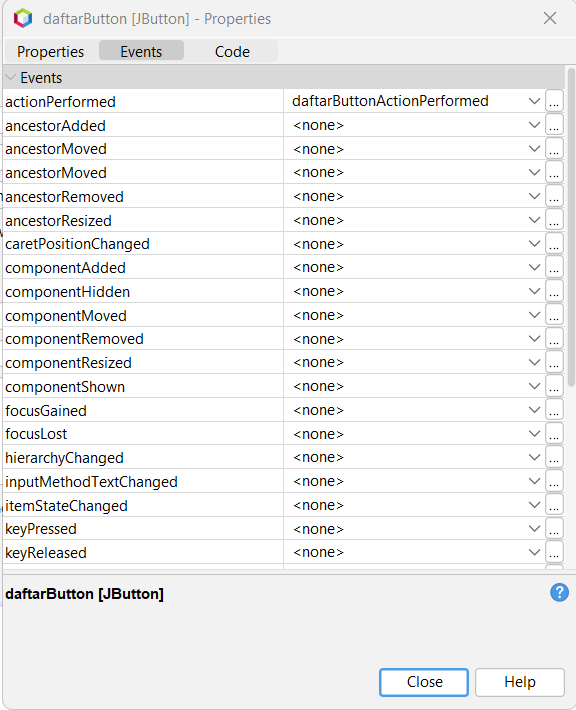
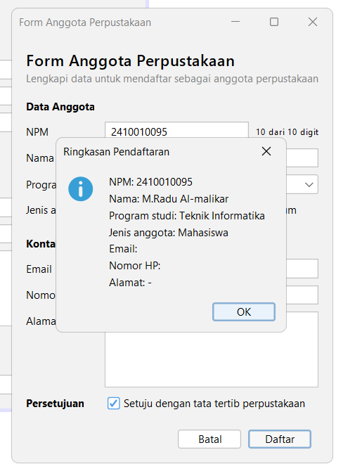
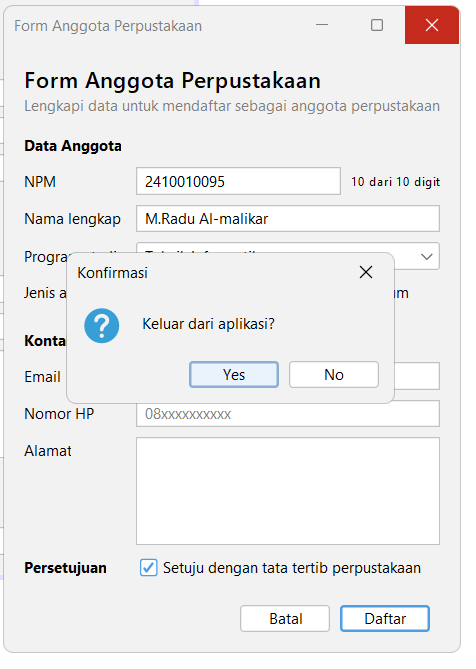

# Tugas 5 - Event Handling

**Nama:** M. Radu Al-malikar
**NPM:** 2410010095

## Tabel Pengamatan Praktikum 2

| No | Tindakan | Event yang tercatat |
|---|---|---|
| 1 | Arahkan kursor ke tombol, lalu jauhkan | MouseEvent kursor masuk ke tombol, lalu MouseEvent kursor keluar dari tombol |
| 2 | Klik tombol Klik saya | MouseEvent kursor masuk ke tombol, lalu ActionEvent tombol diklik |
| 3 | Centang lalu hapus centang Aktifkan fitur | ItemEvent kotak dicentang, lalu ItemEvent centang dihapus |
| 4 | Ganti pilihan dari Pagi menjadi Malam | ItemEvent memilih Malam (tercatat satu kali) |
| 5 | Klik isian, lalu ketik kata "abc" | FocusEvent isian mendapat fokus, lalu KeyEvent huruf a, b, dan c |
| 6 | Klik tombol setelah mengetik di isian | MouseEvent kursor masuk ke tombol, FocusEvent isian kehilangan fokus, lalu ActionEvent tombol diklik |

## Eksperimen Praktikum 3 (Konversi Suhu)

1. Hapus pemeriksaan if (evt.getStateChange() == ItemEvent.SELECTED) dan tambahkan System.out.println("item berubah"); di dalam event handler. Berapa kali pesan tercetak setiap pilihan diganti?

- Pesan tercetak 2 kali setiap pilihan diganti. itemStateChanged dipanggil sekali untuk pilihan lama (DESELECTED) dan sekali untuk pilihan baru (SELECTED). Karena itu pemeriksaan SELECTED diperlukan agar aksi hanya berjalan sekali.

2. Di jendela Properties bagian Events, kosongkan event keyReleased pada celsiusField, lalu buat event keyPressed yang memanggil konversi(). Mengapa hasil yang tampil terlambat satu karakter?

- keyPressed dipanggil saat tombol baru ditekan, sebelum karakternya masuk ke isian. Akibatnya getText() masih mengembalikan teks sebelum karakter terbaru, sehingga hasil selalu tertinggal satu karakter. keyReleased dipanggil setelah karakter masuk ke isian, jadi hasilnya sesuai.

3. Hapus blok try dan catch di method konversi, lalu ketik huruf pada isian. Apa yang muncul di jendela Output?

- Muncul pesan kesalahan java.lang.NumberFormatException: For input string yang berisi huruf yang diketik. Program tidak berhenti, tetapi hasilLabel tidak diperbarui karena Double.parseDouble gagal. Blok try dan catch diperlukan agar kesalahan input ditangani dan pengguna mendapat pesan "Masukkan angka yang valid".

## Eksperimen Praktikum 4 (Kalkulator Sederhana)

1. Buat event actionPerformed untuk kaliButton melalui Events tanpa menghapus lambda di konstruktor, lalu tambahkan System.out.println("kali"); di kedua tempat. Berapa kali pesan tercetak? Mengapa satu tombol sebaiknya hanya memakai satu cara?

- Pesan tercetak 2 kali setiap tombol diklik, karena tombol memiliki dua listener: satu dari event handler GUI Builder dan satu dari lambda. Jika satu tombol memakai dua cara, aksinya berjalan dua kali (misalnya perhitungan atau dialog muncul ganda) dan kode sulit dilacak.

2. Tambahkan tombol % untuk sisa bagi (modulus). Apa saja yang diubah di tab Design dan di tab Source?

- Di tab Design: tambahkan satu Button dengan text % (misalnya bernama modButton) ke operatorPanel dan ubah Columns pada Grid Layout operatorPanel dari 4 menjadi 5.
- Di tab Source: hubungkan tombol ke hitung('%') lewat event handler (atau lambda), tambahkan case '%' -> a % b; pada switch di method hitung, dan perluas pemeriksaan pembagi nol agar juga berlaku untuk operator %.

3. Tekan tombol Hapus. Mengapa kursor langsung berada di isian pertama?

- Karena method hapus memanggil angka1Field.requestFocusInWindow() di baris terakhir, sehingga fokus dipindahkan ke isian pertama dan pengguna dapat langsung mengetik angka baru.

## Latihan Mandiri: Form Anggota Perpustakaan

### Peta Event

| Komponen | Menu Events | Event | Aksi |
|---|---|---|---|
| `setujuCheck` | Item | `itemStateChanged` | Tombol Daftar hanya aktif jika dicentang |
| `batalButton` | Action | `actionPerformed` | Kosongkan semua isian dan kembalikan fokus ke NPM |
| `daftarButton` | Action | `actionPerformed` | Tampilkan ringkasan data dengan JOptionPane |
| `npmField` | Key | `keyReleased` | Label kecil menampilkan jumlah digit, misalnya "8 dari 10 digit" |
| Form (JFrame di Navigator) | Window | `windowClosing` | Minta konfirmasi sebelum aplikasi ditutup |

Properti tambahan di jendela Properties: defaultCloseOperation form diubah menjadi DO_NOTHING dan centang enabled pada tombol Daftar dihilangkan.

### Jendela Properties bagian Events untuk Tombol Daftar

### Dialog Ringkasan

### Dialog Konfirmasi Keluar

## Deklarasi Penggunaan AI

(Saya memakai Claude (Anthropic) untuk menjelaskan langkah pengerjaan modul, memeriksa kode hasil NetBeans, dan membantu menyusun README. Tampilan form disusun sendiri di tab Design memakai JFrame Form dan event dibuat melalui Events di GUI Builder.)