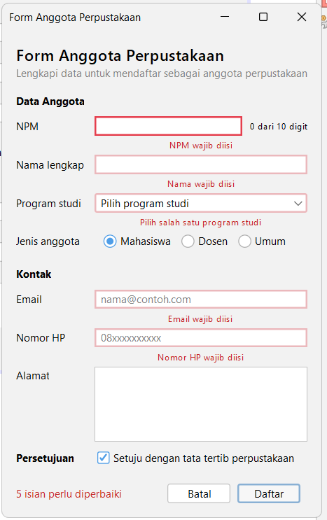
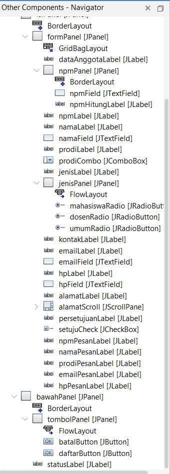

# Tugas 6 - Validasi Input dan Kegunaan

**Nama:** M. Radu Al-malikar
**NPM:** 2410010095

### Form dengan Pesan Kesalahan

### Jendela Navigator dengan Label Pesan

## Eksperimen Praktikum 4

1. Ketik huruf pada isian NPM. Apa yang terjadi dan baris mana di npmFieldKeyTyped yang menyebabkannya?

- Huruf tidak muncul di isian NPM. Penyebabnya baris `if (!Character.isDigit(evt.getKeyChar()) || penuh) { evt.consume(); }`, karena karakter yang bukan angka dibatalkan oleh evt.consume() sebelum masuk ke isian.

2. Isi email dengan siti@, lalu tekan Tab. Kapan pesan kesalahan muncul?

- Pesan muncul saat Tab ditekan dan fokus pindah dari isian email, karena diperiksa di event focusLost. Isian diberi garis merah dan pesan "Format email belum benar, contoh: nama@contoh.com" tampil di label bawahnya.

3. Klik isian Nama tanpa mengetik, lalu tekan Tab. Mengapa tidak ada pesan kesalahan?

- Karena event focusLost hanya memeriksa isian yang sudah diisi (`!namaField.getText().isBlank()`). Isian kosong baru diperiksa saat tombol Daftar diklik, agar pengguna tidak langsung dianggap salah hanya karena melewati isian.

4. Centang persetujuan, lalu klik Daftar dengan form kosong. Isian mana yang mendapat fokus?

- Isian NPM mendapat fokus, karena NPM adalah kesalahan pertama di daftar isian yang salah, dan `salah.get(0).requestFocusInWindow()` memindahkan fokus ke sana. Status menampilkan "5 isian perlu diperbaiki".

5. Tekan tombol Alt bersama huruf N. Isian mana yang mendapat fokus, dan properti apa yang mengaturnya?

- Isian Nama lengkap mendapat fokus. Diatur oleh properti displayedMnemonic (N) pada namaLabel yang terhubung ke namaField melalui properti labelFor.

6. Isi beberapa isian, lalu klik Batal dan pilih No. Apakah data tetap ada?

- Ya, data tetap ada, karena saat jawaban bukan YES_OPTION method langsung return sebelum memanggil kosongkan().

## Deklarasi Penggunaan AI

(Saya memakai Claude (Anthropic) untuk menjelaskan langkah pengerjaan modul, memeriksa kode hasil NetBeans, dan membantu menyusun README. Tampilan form disusun sendiri di tab Design memakai JFrame Form dan event dibuat melalui Events di GUI Builder.)